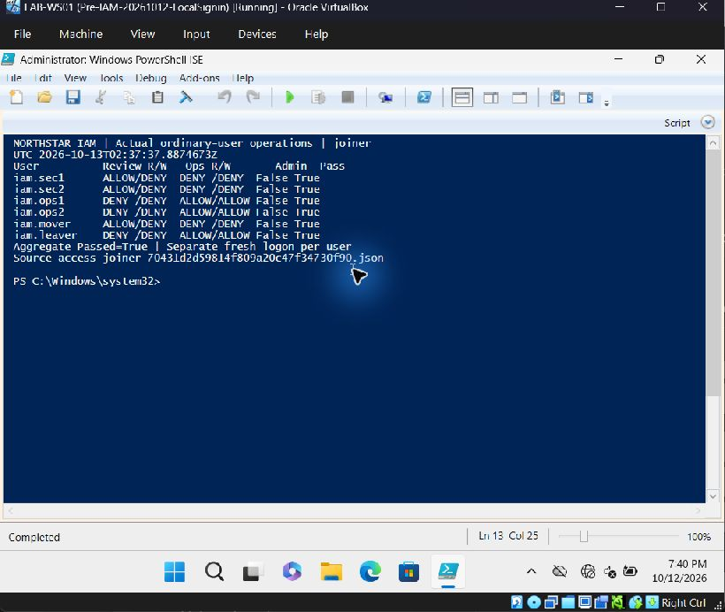
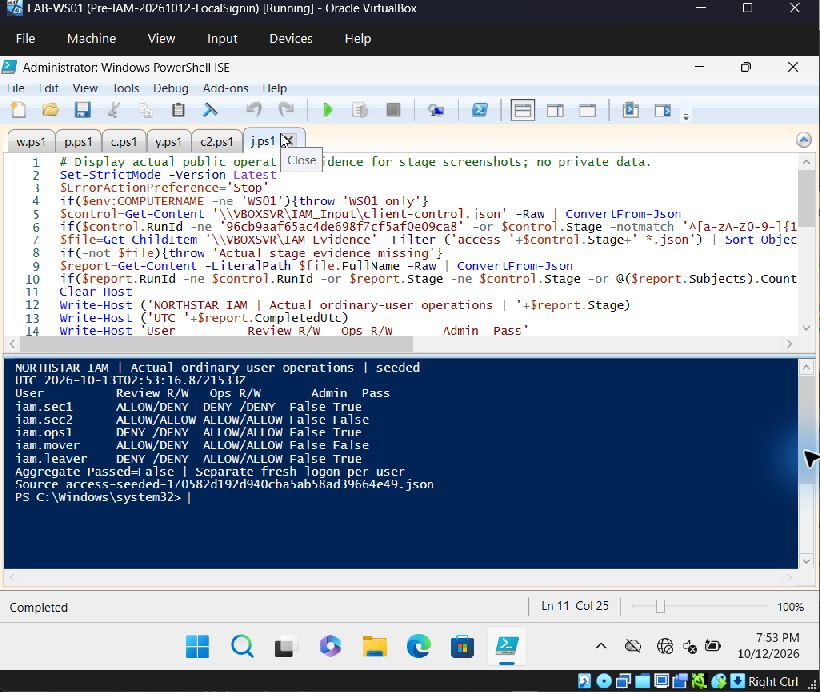
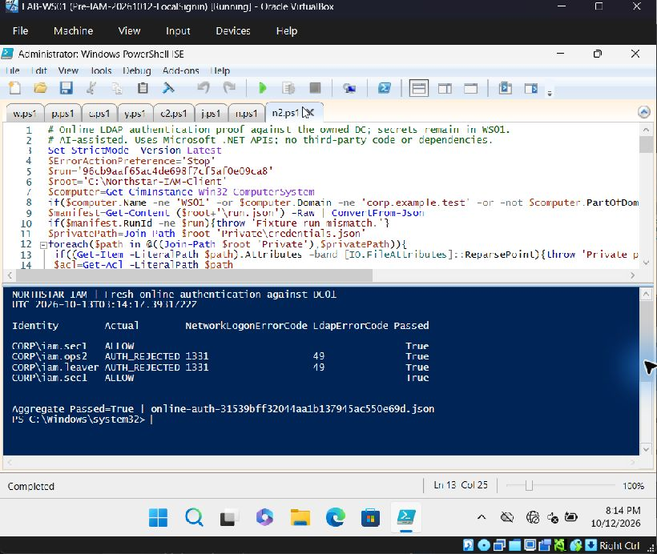

# Northstar IAM lifecycle and access review

Six fictional users in the existing isolated Northstar Active Directory lab exercised onboarding, a role transfer, offboarding and access recertification. Real SMB file operations from fresh ordinary-user processes verified the role boundaries. The exercise deliberately introduced excessive access and a mistaken removal, then measured remediation and recovery.

## Verified results

Guest evidence was recorded on October 13, 2026 UTC. Screenshots supplement the JSON observations; the [evidence index](evidence/index.json) identifies the exact reports used by the verifier.

| Scenario | Actual result |
| --- | --- |
| Joiner | Six users, 24 passing read/write assertions; every test token was nonadministrative. |
| Mover | Six users, 24 passing assertions; the mover lost Review access and gained Ops read/write access. |
| Seeded review | Normal-role checks failed for the excessive direct/group grants and obsolete mover access, as intended. |
| Remediation | Five enabled users passed 20 assertions; the Review ACL matched its original baseline exactly. |
| Mistake and recovery | Removing ops1's legitimate role denied its Ops read/write operations. Actual access returned in **43.14 seconds**, within the 300-second target. |
| Leaver retest | A held SMB write stream failed **4.75 seconds** after disablement; a fresh read was denied at **4.77 seconds**, within the 60-second target. |
| Online authentication | Disabled ops2 and leaver were rejected by NETWORK logon (Win32 1331) and LDAP (49); the healthy control succeeded before and after. |
| Final state | Four enabled users passed all 16 operations; two disabled users had no role memberships. Eight recursive administrative-group checks found zero lab-user matches. |

The first leaver probe observed stream failure, but its broken-handle cleanup threw before the fresh read. Its failed report remains in the evidence set. A scoped retest restored only the fictional leaver's original grant/role, verified the fixed cleanup, and left the account disabled again. The first online-authentication report also remains: an incorrect RootDSE attribute constructor prevented the healthy control from passing. Neither failure is presented as a successful test.

## Access matrix

| Role | Review read | Review write | Ops read | Ops write |
| --- | --- | --- | --- | --- |
| IAM-SecurityReader | Allow | Deny | Deny | Deny |
| IAM-SystemsOperator | Deny | Deny | Allow | Allow |

SecurityReader uses SMB Read and NTFS ReadAndExecute. SystemsOperator uses SMB Change and NTFS Modify. Administration remains separate. The domain is `corp.example.test`; the dedicated OU is `IAM-Lifecycle-Lab` under `Lab`. Resources are `NorthstarIAMReview` and `NorthstarIAMOps` on DC01. Existing analyst accounts, SYSVOL and NETLOGON were outside this exercise.

The [synthetic request and review register](GOVERNANCE.md) records the simulated business decisions and their verification. The [runbook](RUNBOOK.md) documents the tested execution sequence and the guarded, run-specific helpers.

## Evidence and checks

Run these read-only checks from a repository checkout with PowerShell:

```powershell
./labs/iam-lifecycle/Verify-Evidence.ps1
./labs/iam-lifecycle/Test-EvidenceVerifier.ps1
```

The verifier recalculates metrics from observed timestamps, checks each user's actual operations against the role matrix, distinguishes Win32 access-denied code 5 from unrelated failures, validates healthy online controls and disabled-account rejection, and checks final memberships. Sixteen corrupted-evidence cases verify rejection of incorrect roles, administrative tokens, missing operations, stale evidence, incorrect failure classifications, missed timing targets, duplicate administrative-group SIDs, missing directory subjects and contradictory directory state. This validates the recorded artifact; it does not rerun the VMs or authenticate the provenance of their reports.

Seven unedited native guest screenshots are in [screenshots](screenshots/index.json). The directory and final-access screenshots show the state before the cleanup retest; the later JSON and online-auth screenshot verify its resulting state. A screenshot originally saved with a `.png` suffix contained native JPEG bytes; the packaged filename uses `.jpg` without changing the image. [SHA256SUMS.txt](SHA256SUMS.txt) detects subsequent artifact changes, without proving runtime behavior.







## Limits and cleanup

The measured revocation applies to this user's targeted SMB session and owned Ops resource. It does not establish global Kerberos ticket revocation, termination of every possible session, or prevention of offline cached Windows sign-in. The online authentication check was performed separately after offboarding, so no online-authentication latency target is claimed. The eight recursive group checks cover those groups, not every possible Windows privilege path.

DC and WS clocks produced UTC timestamps and the workstation used DC01 as its time source. No independent high-precision clock calibration or external NTP assurance was established. Snapshot creation was verified; snapshot restoration was not exercised. The measured recovery was an inverse membership change. Evaluation operating systems, retained synthetic accounts and protected local fixture credentials remain lab limitations.

The temporary private provisioning share was removed before ordinary-user testing. After final verification, both VirtualBox consoles showed empty global, machine and transient shared-folder lists. WS01's ISE session was closed, ending its Process-only RemoteSigned setting. VM disks and private credentials are excluded from this repository. The four healthy lab users and the two dedicated resource shares are retained for demonstration.

## License and assistance

This extension follows the repository's [MIT license](../../LICENSE). It uses built-in Microsoft AD, SMB, ACL, .NET LDAP and Windows logon APIs. No external implementation code or runtime package was added to the guest helpers. Microsoft, Oracle and guest operating-system licenses remain separate; their binaries are not redistributed.

Codex assisted with implementation, test orchestration, evidence review and writing. A local Ollama `qwen3.5:2b` draft supplied a short public narrative; Codex corrected its unsupported claims. Code review was an implementing-agent ECC self-review, with fixes and affected checks repeated. It was not an independent review. See [learning and review notes](LEARNING.md) and [API references](REFERENCES.md).
